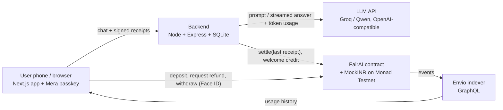
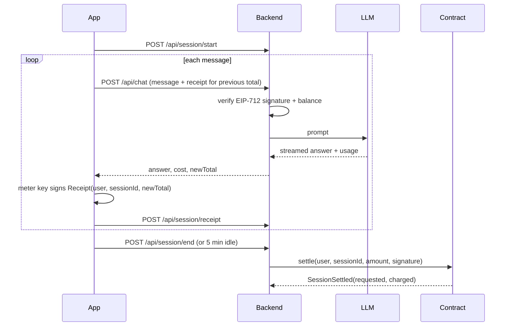

# FairAI

**Pay per answer. Never more than ₹1,950 a month.**

FairAI is an AI chat app where you pay only for the answers you get. Once your spending in a month reaches the price of a normal AI subscription (₹1,950), the rest of the month is free. Your unused balance can always be taken back.

Built for **Monad Metropolis, Track 02: Consumer Products & Payments**, on Monad Testnet.

---

## The problem

Students and freelancers in India pay about ₹1,950 a month for an AI subscription but often use it only a few days a month. They pay for 30 days and use 5.

## The promise

| You use it… | You pay… |
|---|---|
| A little | Only for the answers you got |
| A lot | Never more than ₹1,950 in a month; after that, it's free |
| Not anymore | Get your remaining balance back at any time |

The app looks like any normal consumer app: Face ID sign-up, a balance in rupees, and a live meter. No seed phrases or crypto words, and no transaction pop-ups during chat.

---

## How it works

Think of a prepaid metro card. You load money once, each trip is recorded quietly, and you're charged only for the trips you took.

1. **Sign up with Face ID.** A Mera passkey creates two accounts from one passkey:
   - **Account 0, the wallet:** holds the money. Every money action needs Face ID.
   - **Account 1, the meter key:** can only sign usage receipts. It stays unlocked while the app is open, so chatting needs no prompts.
2. **Welcome credit.** The backend gives the new account a little test MON for fees and ₹500 of test MockINR.
3. **Add ₹200.** One Face ID moves the money into the FairAI contract and registers the meter key.
4. **Chat.** After each answer, the backend prices the tokens used and returns the new running total (for example "₹1.20 so far"). The meter key silently signs an **EIP-712 receipt** for that total. The backend checks the signature and the balance before answering the next message.
5. **Session ends** (you leave, or are idle for 5 minutes). The backend submits **only the last receipt** to the contract. The contract checks the signer, that the session isn't already paid, and the monthly cap. Then it charges at most the remaining cap and balance.
6. **Withdraw.** You request a refund, wait 2 minutes, and get the rest of your balance back. The wait lets open sessions settle first.

### Why users can trust it

- The contract only pays out amounts **the user's own meter key signed**.
- Each session can be settled **once**.
- Charges never exceed the **₹1,950 monthly cap** or the user's balance.
- The user can **always withdraw** what's left.
- Even if the backend were compromised, it couldn't move money outside these rules.

---

## Architecture



### Settlement sequence



---

## Features

- **Face ID sign-up and login** with Mera passkeys. No seed phrase or extension.
- **One passkey, two keys:** a money wallet and a silent meter key.
- **Live meter** in the chat header: "₹2.40 this session · ₹38 of ₹1,950 this month".
- **Pay-per-answer pricing** from real token usage, rounded up to the paisa.
- **Monthly cap**, enforced on-chain: once you reach ₹1,950, further charges are ₹0.
- **Gasless chat:** receipts are signed off-chain, and only one transaction is made per session.
- **Automatic settlement** when you leave or after 5 minutes idle.
- **Refund with a 2-minute safety wait**, and a countdown in the app.
- **Usage dashboard:** balance, spend this month against the cap, spend per day, and a session history with receipt links.
- **No-crypto-words copy check** (`scripts/copy-lint.ts`) runs in lint and CI.

---

## Deployed contracts (Monad Testnet, chain ID 10143)

| Contract | Address |
|---|---|
| MockINR (test ₹ stablecoin, 18 decimals) | [`0x758087d5967667270A8B17F7eEd2c943B09382fd`](https://testnet.monadvision.com/address/0x758087d5967667270A8B17F7eEd2c943B09382fd) |
| FairAI | [`0xe1185e9d91202c4da45805F4c8Ca003b22dF8F45`](https://testnet.monadvision.com/address/0xe1185e9d91202c4da45805F4c8Ca003b22dF8F45) |

Both contracts are source-verified with Monad's Sourcify verifier. FairAI's deployment block is `70919080`. Addresses and ABIs live in [`shared/deployments.json`](shared/deployments.json).

### Contract interface

| Function | Caller | What it does |
|---|---|---|
| `depositAndSetKey(amount, meterKey)` | User | Deposits MockINR, registers the meter key, cancels any pending refund |
| `settle(user, sessionId, amount, signature)` | Relayer | Verifies the EIP-712 receipt, applies the cap, charges `min(amount, remaining cap, balance)` |
| `requestWithdraw()` | User | Starts the 120-second wait |
| `withdraw()` | User | Returns the full balance after the wait |
| `claimEarnings(to)` | Owner | Sends collected earnings out |

Receipt type: `Receipt(address user, bytes32 sessionId, uint256 amount)`. Domain: `FairAI`, version `1`, chain 10143, the FairAI contract address.

Events: `Deposited`, `MeterKeySet`, `SessionSettled`, `WithdrawRequested`, `Withdrawn`, `EarningsClaimed`.

A billing month is a 30-day network period (`block.timestamp / 30 days`), not a calendar month.

---

## Tech stack

| Layer | Tools |
|---|---|
| Blockchain | Monad Testnet |
| Contracts | Solidity 0.8.24, OpenZeppelin v5, Foundry |
| Backend | Node 20, Express 5, TypeScript, viem, SQLite (`better-sqlite3`) |
| AI | Any OpenAI-compatible API. Groq during development; Alibaba Qwen (DashScope) supported |
| Frontend | Next.js 16, React 19, Tailwind CSS 4, viem, Mera passkeys |
| Indexer | Envio HyperIndex (GraphQL) |
| RPC | Alchemy / Monad public RPC |
| Hosting | Vercel (frontend), Render (backend, `render.yaml`) |

---

## Repository structure

```
FAIR-AI/
├── contracts/          Foundry project
│   ├── src/            MockINR.sol, FairAI.sol
│   ├── test/           FairAI.t.sol
│   └── script/         Deploy.s.sol
├── backend/            Express API
│   ├── src/            index, chain, receipts, pricing, qwen (LLM client),
│   │                   relayerQueue, store, sweeper, routes/api, routes/auth
│   └── scripts/        e2e.ts (live smoke test), check-ai.ts
├── frontend/           Next.js app
│   ├── app/            / (sign in), /add, /chat, /usage
│   ├── components/     shell, provider
│   └── lib/            auth (Mera, Privy fallback), api, chain, envio, session
├── shared/             deployments.json: addresses + ABIs
├── scripts/            deploy, verify, export, copy-lint, helper scripts
├── render.yaml         Backend hosting blueprint
└── .github/workflows/  CI: contract tests, lint, backend tests, build
```

---

## Backend API

| Method | Endpoint | Purpose |
|---|---|---|
| POST | `/api/auth/challenge`, `/api/auth/verify` | Sign-in with a signed single-use challenge |
| POST | `/api/onboard` | Welcome credit (test MON + ₹500 MockINR), once per account |
| POST | `/api/session/start` | Open a chat session |
| POST | `/api/chat` | Verify the previous receipt, stream the answer, return `cost` and `newTotal` |
| POST | `/api/session/receipt` | Store the newest signed receipt |
| POST | `/api/session/end` | Settle the last receipt on-chain |
| GET | `/api/session/current/:wallet` | Resume an open session after a refresh |
| GET | `/api/usage/:wallet` | Balance, spend this month, cap, refund timer |
| GET | `/api/sessions/:wallet` | Session history (fallback when Envio is unavailable) |
| GET | `/api/health` | Health check and relayer fee balance |

---

## Run it locally

**Requirements:** Node 20+, Git, and Foundry. Use fresh test-only accounts; never commit private keys.

```bash
git clone https://github.com/15Harish/FAIR-AI.git
cd FAIR-AI
npm install --ignore-scripts
npm install --prefix backend
npm install --prefix frontend
```

On Windows, `--ignore-scripts` is needed because the npm Foundry package has a Unix-style postinstall. `scripts/forge.mjs` launches the right binary.

### Environment variables

Copy each `.env.example` and fill it in:

| File | Variables |
|---|---|
| `contracts/.env` | `MONAD_RPC`, `DEPLOYER_PRIVATE_KEY`, `RELAYER_ADDRESS` |
| `backend/.env` | `MONAD_RPC`, `RELAYER_PRIVATE_KEY`, `LLM_API_KEY`, `LLM_BASE_URL`, `LLM_MODEL` (or `QWEN_*`), `FAIRAI_ADDRESS`, `MOCKINR_ADDRESS`, `FRONTEND_ORIGIN`, `PORT`, `SQLITE_PATH`, `PRICE_IN_PAISE_PER_1K`, `PRICE_OUT_PAISE_PER_1K`, `IDLE_TIMEOUT_MS` |
| `frontend/.env.local` | `NEXT_PUBLIC_BACKEND_URL`, `NEXT_PUBLIC_ENVIO_URL`, `NEXT_PUBLIC_RPC_URL`, `NEXT_PUBLIC_AUTH` (`mera` or `privy`) |

AI provider example (Groq):

```env
LLM_API_KEY=your_groq_key
LLM_BASE_URL=https://api.groq.com/openai/v1
LLM_MODEL=qwen/qwen3.8-27b
```

If `LLM_API_KEY` is empty, the backend falls back to the `QWEN_*` settings (Alibaba DashScope).

### Commands

```bash
npm run contracts:test            # Foundry tests
npm --prefix backend run build
npm --prefix backend test         # pricing + provider tests
npm --prefix backend run dev      # API on http://localhost:3001
npm --prefix frontend run lint    # type check + no-crypto-words check
npm --prefix frontend run dev     # app on http://localhost:3000
```

### Deploying your own contracts

1. Fund the deployer and relayer accounts from https://faucet.monad.xyz.
2. Run the tests, then broadcast `contracts/script/Deploy.s.sol:Deploy`.
3. Export the addresses and ABIs into `shared/deployments.json`:
   ```bash
   npm run export -- contracts/broadcast/Deploy.s.sol/10143/run-latest.json
   ```
4. Verify on MonadVision with Monad's Sourcify verifier.

### Hosting

- **Backend:** Render using `render.yaml`. Use a single instance with a persistent disk for SQLite. Set `FRONTEND_ORIGIN` to the exact frontend URL.
- **Frontend:** Vercel, root directory `frontend`.

---

## Pricing

The default selling price is **5 paise per 1,000 input tokens** and **15 paise per 1,000 output tokens**, rounded up per answer and configurable in `backend/.env`. Each answer is limited to 1,024 output tokens, so at most one answer can ever go unpaid.

---

## Security notes

- Receipts bind the user, session, amount, network and contract, so a signature can't be reused elsewhere.
- Only the relayer can call `settle`, and it can only settle what the user's meter key signed.
- Money values are handled as `bigint` end to end.
- Outgoing relayer transactions are persisted in SQLite and sent one at a time. Failed settlements retry with backoff.
- **Known limitation:** the meter key lives in browser memory while the app is open. It can only sign FairAI receipts, and charges never exceed the monthly cap or balance.
- If the app crashes before a receipt is signed, one answer can go unpaid.
- Welcome credit is once per account but doesn't stop someone creating fresh accounts (testnet only).
- MockINR is test money. Refunds return MockINR to the user's account, not to a bank.

---

## Project status

| Part | Status |
|---|---|
| Smart contracts + Foundry tests (14 passing) | ✅ Done |
| Contracts deployed and verified on Monad Testnet | ✅ Done |
| Backend API, pricing and provider tests | ✅ Implemented |
| Frontend: sign in, add balance, chat with meter, usage and refund | ✅ Implemented |
| Live end-to-end test on testnet (`backend/scripts/e2e.ts`) | ⏳ Pending |
| Passkey flow tested on a real phone | ⏳ Pending |
| Envio indexer | ⏳ Pending (the dashboard falls back to `/api/sessions`) |
| Hosted backend and frontend | ⏳ Pending |
| Privy fallback login | Stub only |

---

## Hackathon integrations

| Sponsor | How FairAI uses it |
|---|---|
| **Monad** | Contracts, settlement and refunds on Monad Testnet |
| **Mera** | Face ID passkey login; one passkey derives two keys (wallet + meter key) |
| **Envio** | Indexes contract events for the usage dashboard (in progress) |
| **Alibaba Cloud Qwen** | Supported AI provider (`QWEN_*` settings) |
| **Alchemy** | RPC connection to Monad Testnet |

---

## Credits

Inspired by **StreamFlow** and **TickPay**.

FairAI is a hackathon project on testnet. It uses no real money.
